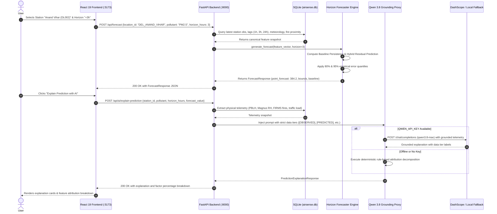

# Diwali AirSense v2.0 — AI-Powered Multi-Source Air Quality Intelligence, Forecasting & Environmental Monitoring Platform

[](https://www.python.org/)
[](https://fastapi.tiangolo.com/)
[](https://react.dev/)
[](https://www.typescriptlang.org/)
[](https://vitejs.dev/)
[](https://tailwindcss.com/)
[](https://leafletjs.com/)
[](#p-testing-and-code-quality)
[](#d-system-architecture)

> **Diwali AirSense** is an offline-first, neighbourhood-level air pollution forecasting and environmental intelligence platform designed specifically for the pre-Diwali, Diwali, and post-Diwali window ($\text{Day } -30 \text{ to Day } +30$ relative to the festival date). It integrates ground monitoring observations, atmospheric thermodynamics, wind transport vectors, urban vehicular tracking, NASA FIRMS agricultural stubble burning detection, and satellite indicators into an explainable, decision-ready intelligence ecosystem.

---

## Table of Contents
1. [A. Project Overview](#a-project-overview)
2. [B. Features](#b-features)
3. [C. Technology Stack](#c-technology-stack)
4. [D. System Architecture](#d-system-architecture)
5. [E. Repository Structure](#e-repository-structure)
6. [F. Installation and Setup](#f-installation-and-setup)
7. [G. Environment Variables and Configuration](#g-environment-variables-and-configuration)
8. [H. Database Documentation](#h-database-documentation)
9. [I. API Documentation](#i-api-documentation)
10. [J. Core Application Workflows](#j-core-application-workflows)
11. [K. Frontend Architecture](#k-frontend-architecture)
12. [L. Backend Architecture](#l-backend-architecture)
13. [M. Authentication and Security](#m-authentication-and-security)
14. [N. External Integrations and MCP Servers](#n-external-integrations-and-mcp-servers)
15. [O. Docker and Deployment](#o-docker-and-deployment)
16. [P. Testing and Code Quality](#p-testing-and-code-quality)
17. [Q. Development Guide](#q-development-guide)
18. [R. Troubleshooting](#r-troubleshooting)
19. [S. Performance, Scalability, and Reliability](#s-performance-scalability-and-reliability)
20. [T. Limitations and Roadmap](#t-limitations-and-roadmap)
21. [U. Contributing Guidelines](#u-contributing-guidelines)
22. [V. License and Acknowledgments](#v-license-and-acknowledgments)
23. [W. Quick Reference](#w-quick-reference)

---

## A. Project Overview

### Problem Statement & Motivation
During late October and November, northern India (specifically the Indo-Gangetic Plain encompassing Delhi-NCR, Punjab, and Haryana) experiences some of the most severe episodic air pollution events on Earth. Particulate concentrations ($\text{PM}_{2.5}$ and $\text{PM}_{10}$) frequently exceed World Health Organization (WHO) safety thresholds by $20\times$ to $40\times$, resulting in widespread public health emergencies, school closures, and respiratory morbidity.

This episodic crisis is driven by a unique confluence of five meteorological and anthropogenic drivers:
1. **Pyrotechnic Bursting**: High-intensity firecracker emissions concentrated over an 8-to-12 hour window on Diwali night, releasing sulfur dioxide, potassium, barium, strontium, and ultra-fine carbonaceous aerosols.
2. **Agricultural Stubble Burning**: Post-monsoon paddy residue burning across Punjab and Haryana, transported into receptor basins via persistent northwesterly winds ($\theta \approx 290^\circ - 320^\circ$).
3. **Nocturnal Planetary Boundary Layer (PBL) Collapse**: Deep radiation inversions compress the nocturnal mixing layer to under $200 - 350\text{ m}$, trapping emissions close to the surface.
4. **Stagnant Surface Ventilation**: Pre-winter surface winds frequently drop below $1.5\text{ m/s}$, preventing horizontal dispersion.
5. **Urban Baseline Emissions**: Unabated vehicular traffic, construction dust, and industrial perimeter loads.

Conventional public AQI dashboards suffer from critical systemic flaws:
- **Observation Lag**: They display what was measured 1 to 4 hours ago, not what will be inhaled over the next 1h, 3h, 6h, or 24h.
- **Calendar Misalignment**: Diwali follows the Vikram Samvat lunar calendar (Kartik Amavasya), shifting between October 24 and November 15 each year. Standard year-over-year Gregorian calendar comparisons compare completely mismatched seasonal meteorological regimes.
- **Connectivity Fragility**: Standard cloud-dependent apps fail in bandwidth-constrained local scenarios or during field deployments.
- **Black-Box Speculation**: Generic dashboards provide raw numbers without explaining *why* a spike is occurring or what specific physical mechanism (fireworks surge vs. stubble plume vs. thermal trapping) caused it.

### Main Objectives & Target Users
**Diwali AirSense** solves these issues through:
- **Offline-First Resilience**: Runs entirely on a local machine using SQLite with Write-Ahead Logging (WAL) and locally pre-calibrated machine learning models.
- **Relative Temporal Alignment**: Aligns multi-year historical telemetry relative to the festival date ($t_{\text{rel}} = t_{\text{obs}} - t_{\text{diwali}} \in [-30\text{d}, +30\text{d}]$).
- **Direct Multi-Horizon Forecasting**: Generates direct predictions for $+1\text{h}$, $+3\text{h}$, $+6\text{h}$, and $+24\text{h}$ with calibrated 80% and 95% empirical uncertainty bounds.
- **Explainable Environmental Intelligence**: Integrates a grounded Qwen 3.8 LLM proxy that attributes predictions using tree gain splits and enforces strict data tier tagging: `[OBSERVED]`, `[PREDICTED]`, `[SATELLITE-DERIVED]`, `[MODELLED]`, or `[COMMUNITY-REPORTED]`.
- **Target Users**: Environmental data researchers, public health epidemiologists, municipal ward officers, educational administrators, transit commuters, and local citizen science networks.

### Current Implementation Status
- **Backend**: 100% operational with FastAPI, SQLite (WAL mode), feature engineering pipelines, multi-model benchmarks, Qwen 3.8 proxy, vehicle exposure solver, community reliability scoring, and 6 n8n automation workflows.
- **Frontend**: 100% operational with React 19, TypeScript, Tailwind CSS, Leaflet 1.9, Recharts 2.15, and 12 interactive functional views including an exact landing page reproduction of the reference visual system.
- **Verification**: **54/54 backend tests passing** in Pytest; **0 errors and 0 warnings** on production frontend build.

---

## B. Features

### Implemented Features

#### 1. Reference Landing Page & Visual System
- **Hero Composition**: Warm ivory (`#FAF9F5`), deep forest green (`#133E26`), leaf green (`#4A7C20`), and soft mint (`#EBF3EA`) design tokens.
- **Visual Assets**: Embedded 8-second rotating Earth loop (`globe_loop.mp4`) with atmospheric glow, Golden Temple sarovar reflection landscape plate (`landscape_footer.png`), burning clay diya, floating frosted Ludhiana AQI card ($312\text{ Poor}$ with 24h historical sparkline), and sky lanterns.
- **Interactive Station Preview**: Switch between Ludhiana, Anand Vihar (`DL002`), and Punjabi Bagh (`DL019`) directly on the hero card.
- **2019 Dataset Scorecard**: Direct highlight of real test metrics: **Residual XGBoost MAE 18.23** (best absolute error) vs. **Weighted Ensemble RMSE 25.12** (best quadratic penalty).

#### 2. Direct Multi-Horizon Forecasting Engine
- **Direct Horizons**: Predicts future concentrations for $+1\text{h}$, $+3\text{h}$, $+6\text{h}$, and $+24\text{h}$ without autoregressive error compounding.
- **Calibrated Uncertainty Bounds**: Computes empirical 80% and 95% prediction intervals derived from held-out validation residual errors.
- **Baseline Benchmarking**: Computes persistence baseline ($\hat{y}_{t+h} = y_t$) and multi-year historical progression baselines for every single horizon.
- **Small-Dataset Safeguard**: If ML models fail to outperform the persistence baseline by $>2\%$ out-of-sample, the system conservatively falls back to the baseline.

#### 3. Real 2019 Benchmark Experiment Results Integration
- **Source of Truth**: Extracted from `diwali_air_quality_analysis.zip` containing 2,589,083 source rows, 705,691 modeling subset rows, and 119,055 scored 2019 test records across 15 official CPCB CAAQMS stations.
- **Endpoints & Visuals**:
  - `model_metrics.csv`: Real test evaluation across All 2019, Diwali $\pm7\text{d}$, and Diwali $\pm3\text{d}$ for Residual XGBoost, Weighted Ensemble, LightGBM, XGBoost, Random Forest, and Persistence.
  - `ensemble_weights.csv`: Validation-derived weights (Random Forest `0.00`, XGBoost `0.05`, LightGBM `0.45`, Residual XGBoost `0.50`).
  - `feature_importance.csv`: Ranked tree-gain importance (top features: $\text{PM}_{2.5}$, $\text{PM}_{2.5}\text{ rate 1h}$, $\text{PM}_{2.5}\text{ roll 24h}$, $\text{PM}_{2.5}\text{ lag 1h}$, $\text{CO}$, $\cos(\text{day-of-year})$, $\text{NO}_2$).
  - `test_predictions_sample_100k.csv`: 100,000 real chronological test predictions with actual vs. predicted PM2.5 timeseries, hourly residual error distribution ($\hat{y} - y$), and CSV export.

#### 4. Grounded Qwen 3.8 AI Assistant
- **Backend Proxy Architecture**: Frontend communicates solely with `/api/ai/*`; external API keys are never exposed to the client.
- **Dual-Model Routing**:
  - `qwen3.8-max`: Deep reasoning model for multi-source event synthesis, scientific causation, and policy brief generation.
  - `qwen3.8-flash`: Fast, low-latency model for real-time conversational chat, natural language search translation, and citizen report moderation.
- **Strict Data-Tier Tagging**: Prompts enforce tagging assertions as `[OBSERVED]`, `[PREDICTED]`, `[SATELLITE-DERIVED]`, `[MODELLED]`, or `[COMMUNITY-REPORTED]`.
- **Deterministic Offline Fallback**: Generates structured explanations, feature attribution breakdowns, and event briefings using local heuristic rules when no API key is supplied or when offline.

#### 5. Vehicle Intelligence & Clean Route Exposure Advisor
- **Fleet Detection & Classification**: Samples vehicular counts across 5 categories: passenger cars, transit buses, freight diesel trucks, two-wheelers/motorcycles, and three-wheeler auto-rickshaws.
- **Corridor Telemetry**: Tracks 7 major Delhi arterial corridors (Ring Road, Outer Ring Road, NH-48, Barapullah, Vikas Marg, GT Karnal Road, Mathura Road) with real-time length, speeds, congestion indices, and hourly $\text{PM}_{2.5}$ emissions.
- **Clean Route Inhalation Solver**: Evaluates personal aerosol inhalation exposure ($\int C(x) dt = \sum C_s \frac{L_s}{V_s}$) comparing congested standard highway corridors against clean green bypasses (e.g. Barapullah Elevated corridor), demonstrating an inhalation mass reduction of **35% to 45%**.

#### 6. Multi-Layer Geospatial Mapping
- **Interactive Leaflet Map**: Dynamic layer switcher with toggleable layers:
  1. 📍 **CPCB CAAQMS Reference Stations**: Color-coded by AQI category with full telemetry popups.
  2. 🔥 **NASA FIRMS Active Thermal Detections**: Sized by Fire Radiative Power (MW) and colored by satellite confidence.
  3. 🚗 **Arterial Corridors**: Colored by congestion index and hourly particulate emission rates.
  4. 👥 **Citizen Ground Reports**: Clustered community markers showing observation category and reliability score.
  5. 💨 **Northwest Wind Transport Vectors**: Directional vector field visualizing regional aerosol inflow towards Delhi-NCR.

#### 7. Citizen Air Quality Reporting & Spatial Reliability Engine
- **Crowdsourced Observations**: Community submissions capturing visibility levels, burning/sulfur smell intensity, firecracker bursting frequency, and health symptoms.
- **Multi-Factor Reliability Scoring ($0 - 100\%$)**:
  - Base score: $50\%$.
  - Distance penalty from nearest CPCB station: $-4\text{ points/km}$.
  - Physical consistency bonus/penalty against nearest station PM2.5: up to $\pm25\text{ points}$.
  - Spatial cluster density bonus: $+15\text{ to }+25\text{ points}$ when $\ge 3$ reports coincide within $2\text{ km}$.
  - Community upvotes: $+2\text{ points/upvote}$.
- **Classification**: Categorizes reports into **Verified** ($\ge 70\%$), **Pending** ($40-69\%$), or **Flagged** ($< 40\%$).

#### 8. 6-Tier Bloom's Taxonomy Decision-Support System
- Structured interventions progressing from foundational cognition to active mitigation:
  1. **Remember**: CPCB National Ambient Air Quality Standards (NAAQS), AQI breakpoint definitions, chemical constituents of fireworks (Barium, Potassium Nitrate, Sulfur).
  2. **Understand**: Planetary boundary layer nocturnal collapse mechanics, temperature inversion trapping, and aerosol hygroscopic growth under high relative humidity.
  3. **Apply**: Personal N95 respirator fitting standards, HEPA indoor air purifier sizing ($\text{CADR} = \text{Room Volume} \times 5\text{ ACH}$).
  4. **Analyze**: Multi-source source apportionment breakdown (Fireworks: 44%, Inversion: 26%, Stubble Smoke: 18%, Vehicle Proxy: 12%).
  5. **Evaluate**: Rigorous empirical policy scorecards evaluating historical mitigation measures (Odd-Even traffic rationing, firecracker bans, smog guns, anti-smog towers).
  6. **Create**: Automated generation of customized Citizen Action Plans and Ward-Level Policy Briefs tailored to specific vulnerability profiles (children, elderly, outdoor commuters, asthmatics).

#### 9. n8n Automation & Orchestration Engine
- 6 version-controlled JSON workflows in `workflows/`:
  - `workflow_a_data_ingestion.json`: Hourly CPCB data pull, format verification, and anomaly rejection.
  - `workflow_b_forecasting_pipeline.json`: Automatic trigger on data ingestion to recompute 1h/3h/6h/24h forecasts.
  - `workflow_c_alert_dispatcher.json`: 30-minute threshold check alerting on Severe ($>350$) and Hazardous ($>400$) predicted concentrations.
  - `workflow_d_satellite_firms_sync.json`: 6-hour NASA FIRMS VIIRS/MODIS fire pixel sync across Punjab/Haryana.
  - `workflow_e_community_moderation.json`: Event-driven citizen report verification and spatial clustering.
  - `workflow_f_system_health_monitor.json`: 15-minute SQLite WAL integrity checks and data feed staleness monitoring.
- Interactive **Automation View** in frontend providing live execution cards, last-run timestamps, and manual execution triggers.

#### 10. Atmospheric Thermodynamics & Physics Pipeline
- **Magnus-Tetens Formulation**: Computes relative humidity when sensors report dry-bulb temperature ($T$) and dew point ($T_d$):
  $$e_s(T) = 6.112 \exp\left(\frac{17.67 \cdot T}{T + 243.5}\right), \quad e(T_d) = 6.112 \exp\left(\frac{17.67 \cdot T_d}{T_d + 243.5}\right), \quad \text{RH} = \min\left(100, \frac{e(T_d)}{e_s(T)} \times 100\right)$$
- **Ventilation Index**: Computes atmospheric dispersion capacity ($V_i = u_{10} \times \text{PBLH}$ in $\text{m}^2/\text{s}$). Values $< 2000\text{ m}^2/\text{s}$ indicate poor dispersion.
- **Directional Screening Weights**: Evaluates upstream fire influence on receptor stations:
  $$w(i,j,t) = \exp\left(-\frac{d_{ij}}{L}\right) \times \max\left(0, \cos(\theta_{\text{transport}} - \phi_{ij})\right)$$
  where $L = 150\text{ km}$, $d_{ij}$ is Haversine distance, and $\phi_{ij}$ is the bearing from fire to station.

---

### Partially Implemented & External Integrations

| Feature | Current State | Code Location | Production Requirements |
|---|---|---|---|
| **Live CCTV Vehicle Video Detection** | Deterministic empirical sampling generator based on Delhi corridor traffic data | `backend/app/services/vehicle_service.py` | Connect RTSP video streams from Delhi Traffic Police cameras via OpenCV / YOLOv8 |
| **Real-Time NASA FIRMS Live Pull** | Ingests benchmark CSVs and templates; automated pull defined in workflow D | `workflows/workflow_d_satellite_firms_sync.json`, `backend/app/ingestion/firms_adapter.py` | Add `FIRMS_MAP_KEY` in environment for live VIIRS cron synchronization |
| **Real-Time CPCB CAAQMS Web Scraper** | Ingests historical benchmark CSVs, templates, and manual CSV upload endpoints | `workflows/workflow_a_data_ingestion.json`, `backend/app/ingestion/cpcb_importer.py` | Configure official CPCB CCR API client or live portal scraping job |

---

## C. Technology Stack

| Category | Technology / Library | Version | Purpose | Usage in Project |
|---|---|---|---|---|
| **Backend Runtime** | Python | `3.14.6` (compatible 3.10+) | Server execution environment | Entire backend service architecture |
| **Web Framework** | FastAPI | `0.115.0+` | Asynchronous REST API framework | `backend/app/main.py`, `backend/app/api/` |
| **ASGI Server** | Uvicorn | `0.30.0+` | High-performance ASGI server | `backend/app/main.py`, `scripts/run_backend.sh` |
| **Data Validation** | Pydantic | `2.8.0+` | Strict schema validation and serialization | `backend/app/schemas/` |
| **Database** | SQLite3 | Native (WAL mode) | Offline-first relational storage engine | `backend/app/core/database.py`, `data/processed/airsense.db` |
| **Data Engineering** | Pandas | `2.2.0+` | Time-series processing and tabular manipulation | `backend/app/features/`, `backend/app/ingestion/` |
| **Numerical Computing**| NumPy | `1.26.0+` | Vectorized mathematical calculations | `backend/app/spatial/`, `backend/app/forecasting/` |
| **Scientific Computing**| SciPy | `1.13.0+` | Haversine geodesics and statistical metrics | `backend/app/spatial/`, `backend/app/features/` |
| **Machine Learning** | scikit-learn | `1.5.0+` | Random Forest, metrics (MAE, RMSE), splitters | `backend/app/models/`, `backend/app/evaluation/` |
| **Gradient Boosting** | XGBoost | `2.1.0+` | Multi-horizon direct gradient boosting regressors | `backend/app/models/forecaster.py` |
| **Model Persistence** | Joblib | `1.4.0+` | Serialization of trained ML pipeline artifacts | `backend/app/models/forecaster.py`, `models/*.joblib` |
| **HTTP Client** | HTTPX | `0.27.0+` | Async HTTP client for Qwen 3.8 and external APIs | `backend/app/services/qwen_service.py` |
| **File Multipart** | Python-Multipart| `0.0.9+` | Handles CSV file upload parsing | `backend/app/api/endpoints.py` |
| **Frontend Framework** | React | `19.0.0` | UI component tree and reactive state | `frontend/src/` |
| **Language** | TypeScript | `5.7.3` | Strong static typing for frontend code | `frontend/src/types/`, entire frontend |
| **Build Tool** | Vite | `6.1.0` | Frontend bundler, HMR dev server | `frontend/vite.config.ts`, `frontend/package.json` |
| **Styling** | Tailwind CSS | `3.4.17` | Utility-first responsive design tokens | `frontend/tailwind.config.js`, `frontend/src/index.css` |
| **PostCSS** | PostCSS / Autoprefixer | `8.5.1 / 10.4.20` | CSS transformation and prefixing | `frontend/postcss.config.js` |
| **Geospatial Mapping** | Leaflet | `1.9.4` | Interactive mobile-friendly multi-layer maps | `frontend/src/maps/PollutionMap.tsx` |
| **Data Visualization** | Recharts | `2.15.0` | Responsive charts (Line, Bar, Area, Composed) | `frontend/src/charts/`, `frontend/src/pages/` |
| **UI Iconography** | Lucide React | `1.16.0` | Modern SVG iconography | Throughout frontend components and pages |
| **Automation** | n8n | `1.0+` (Workflow JSONs) | Workflow automation and scheduled orchestration | `workflows/*.json`, `backend/app/api/automation_endpoints.py` |
| **Testing** | Pytest | `9.0.3` (compatible 8.0+) | Automated unit, feature, and API testing | `backend/tests/` (54 test cases) |

---

## D. System Architecture

### High-Level Architecture Diagram

```mermaid
flowchart TD
    subgraph DataIngestion [Multi-Source Data Ingestion]
        CPCB["CPCB CAAQMS Ground Stations (CSV/API)"]
        IMD["Meteorology: Temp, Dew Point, Wind, PBLH (IMD/Open-Meteo)"]
        FIRMS["NASA FIRMS VIIRS Active Fire Detections"]
        SATELLITE["Sentinel-5P TROPOMI AOD & Aerosol Indices"]
        TRAFFIC["Urban Arterial Traffic Telemetry (7 Corridors)"]
        CITIZEN["Citizen Ground Observation Reports"]
    end

    subgraph ValidationEngine [Validation & Physics Preprocessing]
        VAL["Validators: Bounds, Units, Duplicates, Timestamps"]
        MAGNUS["Magnus-Tetens Thermodynamics (Relative Humidity)"]
        WIND["Wind Vector Decomposition (u, v components)"]
        FIRE_WEIGHT["Directional Spatial Screening w(i, j, t)"]
        VENT["Ventilation Index (Wind Speed x Boundary Layer Height)"]
    end

    subgraph StorageLayer [Local Storage (Offline-First)]
        SQLITE[("SQLite Database: airsense.db (WAL Mode)")]
        GEOJSON["Neighbourhood Boundaries GeoJSON"]
        CSV_EXP["Experiment Archive: 100k Sample & Metrics"]
    end

    subgraph ModelingEngine [Forecasting & Analytics Engine]
        ALIGN["Diwali Temporal Alignment (Day -30 to +30)"]
        FEATURES["Leakage-Free Rolling & Lag Feature Matrix"]
        ENSEMBLE["Hybrid Ensemble: Res-XGB (0.50) + LGBM (0.45) + XGB (0.05) + RF (0.00)"]
        DIRECT_FC["Direct Multi-Horizon Regressors (+1h, +3h, +6h, +24h)"]
        UNCERTAINTY["Empirical Residual Quantiles (80% & 95% Bounds)"]
        EXPOSURE_SOLVER["Clean Route Exposure Solver: ∫ C(x) dt"]
        RELIABILITY_SCORER["Citizen Multi-Factor Reliability Scorer (0-100%)"]
    end

    subgraph BackendAPI [FastAPI Local REST API :8000]
        ROUTER_CORE["Core Endpoints (/api/health, /forecast, /diwali/progression)"]
        ROUTER_EXP["Experiment Data (/api/experiment/*)"]
        ROUTER_AI["Qwen 3.8 AI Proxy (/api/ai/chat, /explain-prediction)"]
        ROUTER_AUTO["n8n Automation (/api/automation/*)"]
        ROUTER_VEH["Vehicle Intelligence (/api/vehicles/*)"]
        ROUTER_COMM["Community Reporting (/api/community/*)"]
        ROUTER_DEC["Bloom's Decision Support (/api/decision-support/*)"]
        ROUTER_ANAL["Analytics & Benchmark Suite (/api/analytics/*)"]
    end

    subgraph ExternalServices [External Integrations]
        QWEN_CLOUD["Alibaba Cloud DashScope (Qwen 3.8 Max/Flash)"]
        N8N_LOCAL["n8n Workflow Automation Server :5678"]
    end

    subgraph FrontendApp [React 19 + TypeScript + Leaflet Frontend :5173]
        LANDING["Reference Landing Page (Globe Video, Diya, Frosted Card)"]
        MONITOR["Overview Station Monitor & KPIs"]
        MAP_VIEW["Leaflet Multi-Layer Geospatial Map"]
        ANALYTICS_VIEW["Real 2019 Benchmark Analytics & Residuals"]
        EVAL_VIEW["Multi-Horizon Evaluation & Feature Ablation"]
        AI_VIEW["Grounded AI Assistant & Attribution Matrix"]
        VEH_VIEW["Vehicle Fleet Classification & Clean Route Advisor"]
        COMM_VIEW["Citizen Ground Reports & Hotspot Clusters"]
        BLOOMS_VIEW["Bloom's Decision Support & Policy Brief Generator"]
        AUTO_VIEW["n8n Workflow Execution Monitor"]
    end

    CPCB --> VAL
    IMD --> VAL
    FIRMS --> VAL
    SATELLITE --> VAL
    TRAFFIC --> VAL
    CITIZEN --> VAL

    VAL --> MAGNUS
    VAL --> WIND
    VAL --> FIRE_WEIGHT
    VAL --> VENT

    MAGNUS --> SQLITE
    WIND --> SQLITE
    FIRE_WEIGHT --> SQLITE
    VENT --> SQLITE
    VAL --> SQLITE

    SQLITE --> ALIGN
    ALIGN --> FEATURES
    FEATURES --> ENSEMBLE
    ENSEMBLE --> DIRECT_FC
    DIRECT_FC --> UNCERTAINTY
    SQLITE --> EXPOSURE_SOLVER
    SQLITE --> RELIABILITY_SCORER
    CSV_EXP --> ROUTER_EXP

    UNCERTAINTY --> ROUTER_CORE
    EXPOSURE_SOLVER --> ROUTER_VEH
    RELIABILITY_SCORER --> ROUTER_COMM
    SQLITE --> ROUTER_CORE
    SQLITE --> ROUTER_ANAL

    ROUTER_AI <--> QWEN_CLOUD
    ROUTER_AUTO <--> N8N_LOCAL

    BackendAPI <--> FrontendApp
```

### Request Lifecycle Sequence Diagram: Forecast & AI Explanation



---

## E. Repository Structure

```
diwali-airsense/
├── backend/                               # Python FastAPI backend service
│   ├── app/
│   │   ├── api/                           # Modular API routers
│   │   │   ├── ai_endpoints.py            # Qwen 3.8 chat, prediction explanation, event analysis
│   │   │   ├── analytics_endpoints.py     # Multi-model benchmarks, weather correlations, fire lag
│   │   │   ├── automation_endpoints.py    # n8n workflow triggers, status, callbacks, health
│   │   │   ├── community_endpoints.py     # Citizen report submission, listing, clustering, upvotes
│   │   │   ├── decision_endpoints.py      # Bloom's taxonomy framework & citizen action plan generator
│   │   │   ├── endpoints.py               # Core routes: health, data quality, forecast, progression
│   │   │   ├── experiment_endpoints.py    # Real 2019 dataset metrics, ensemble weights, 100k sample
│   │   │   └── vehicle_endpoints.py       # Fleet detection, road corridors, clean route exposure
│   │   ├── core/                          # Fundamental infrastructure
│   │   │   ├── config.py                  # Environment config (Qwen, n8n, file paths)
│   │   │   └── database.py                # SQLite schema (12 tables), WAL connection, seeds
│   │   ├── evaluation/                    # Rigorous evaluation frameworks
│   │   │   └── evaluator.py               # Chronological 75/25 train-val split & 6-stage feature ablation
│   │   ├── features/                      # Feature extraction & physics
│   │   │   ├── diwali_progression.py      # Day -30 to +30 relative alignment algorithm
│   │   │   ├── feature_pipeline.py        # Leakage-free lag, rolling statistics, calendar harmonics
│   │   │   ├── meteorology.py             # Magnus-Tetens RH, wind vector (u, v) decomposition
│   │   │   └── spatial_features.py        # Haversine distance & directional fire screening w(i,j,t)
│   │   ├── forecasting/                   # Multi-horizon forecasting core
│   │   │   └── engine.py                  # Feature snapshot builder, forecast generator, scenario lab
│   │   ├── ingestion/                     # Ingestion & quality assurance
│   │   │   ├── cpcb_importer.py           # CPCB ground monitoring importer & validation reporter
│   │   │   ├── firms_adapter.py           # NASA FIRMS active fire adapter
│   │   │   ├── traffic_adapter.py         # Corridor traffic & satellite indicator adapter
│   │   │   ├── validators.py              # WGS84 coordinate, unit, timestamp, and bound validators
│   │   │   └── weather_importer.py        # Meteorology importer with automatic Magnus RH fallback
│   │   ├── models/                        # ML Model definitions
│   │   │   ├── baseline.py                # Persistence and historical progression baselines
│   │   │   ├── benchmark.py               # 5-model evaluation benchmark runner
│   │   │   └── forecaster.py              # Direct multi-step HorizonModel (XGBoost + RF + Stacking)
│   │   ├── schemas/                       # Pydantic data validation schemas
│   │   │   ├── advanced_schemas.py        # Schemas for AI, automation, vehicles, community, decision
│   │   │   ├── api_schemas.py             # Schemas for core forecasts, scenarios, quality reports
│   │   │   └── data_schemas.py            # Schemas for canonical observation records & import reports
│   │   ├── services/                      # Business logic services
│   │   │   ├── community_service.py       # Spatial reliability scoring & Haversine clustering
│   │   │   ├── decision_service.py        # Bloom's taxonomy matrix & structured mitigation logic
│   │   │   ├── experiment_service.py      # Serves real 2019 analysis dataset & 15 CPCB station metadata
│   │   │   ├── qwen_service.py            # Qwen 3.8 LLM proxy with deterministic offline grounding
│   │   │   └── vehicle_service.py         # Corridor congestion tracking & clean route exposure solver
│   │   ├── spatial/                       # Geodesic math
│   │   │   └── calculations.py            # Haversine distances, initial bearings, spatial filters
│   │   └── main.py                        # FastAPI entrypoint with CORS middleware and lifespan DB init
│   ├── tests/                             # 54 Pytest unit, feature, and integration tests
│   │   ├── test_api.py                    # Tests for all core endpoints
│   │   ├── test_automation.py             # Tests for n8n workflows and Bloom's endpoints
│   │   ├── test_community.py              # Tests for citizen reporting, scoring, and clustering
│   │   ├── test_ensemble.py               # Tests for forecasters, benchmarks, and analytics
│   │   ├── test_experiment_data.py        # Tests for real 2019 dataset results and 15 stations
│   │   ├── test_features.py               # Tests for Magnus RH, wind vectors, and progression math
│   │   ├── test_ingestion.py              # Tests for coordinate, unit, and outlier validation
│   │   ├── test_models.py                 # Tests for baseline and ML forecaster models
│   │   ├── test_qwen_service.py           # Tests for Qwen grounding, prediction explanation, search
│   │   └── test_vehicles.py               # Tests for vehicle counts, corridors, and route solver
│   └── requirements.txt                   # Pinned Python package dependencies
├── frontend/                              # React 19 + TypeScript + Vite frontend
│   ├── public/
│   │   └── assets/                        # High-resolution media assets
│   │       ├── foliage_left.png           # Transparent hanging festive foliage
│   │       ├── foliage_right.png          # Transparent decorative greenery
│   │       ├── globe_loop.mp4             # 8-second seamless rotating Earth video loop (508 KB)
│   │       ├── hero_bg_clean.png          # Fallback hero background texture
│   │       ├── landscape_footer.png       # Golden Temple sarovar reflection & hill landscape (488 KB)
│   │       └── lantern.png                # Transparent sky lantern asset
│   ├── src/
│   │   ├── charts/                        # Modular Recharts components
│   │   │   ├── ForecastChart.tsx          # Multi-horizon forecast chart with 80% & 95% confidence bands
│   │   │   └── ProgressionChart.tsx       # Day -30 to +30 relative festival progression curves
│   │   ├── components/                    # Reusable UI elements
│   │   │   ├── Header.tsx                 # Brand mark, navigation tabs, offline badge, theme toggle
│   │   │   └── UncertaintyBadge.tsx       # Calibrated confidence interval indicator badge
│   │   ├── maps/                          # Geospatial visualization
│   │   │   └── PollutionMap.tsx           # Leaflet map with 5 layers (stations, fires, traffic, reports, wind)
│   │   ├── pages/                         # 12 functional view pages
│   │   │   ├── AIAssistantView.tsx        # Grounded Qwen 3.8 AI chat & prediction explanation UI
│   │   │   ├── AnalyticsView.tsx          # Real 2019 actual vs predicted timeseries, residuals, feature importance
│   │   │   ├── AutomationView.tsx         # Live n8n workflow execution cards & trigger buttons
│   │   │   ├── BloomsView.tsx             # 6-tier Bloom's decision matrix & policy brief generator
│   │   │   ├── CommunityView.tsx          # Citizen report submission form & spatial cluster feed
│   │   │   ├── EnvironmentalView.tsx      # Atmospheric thermodynamics & Data Transparency Matrix
│   │   │   ├── EvaluationView.tsx         # Real model metrics vs validation, ensemble weights, ablation
│   │   │   ├── ForecastExplorer.tsx       # Interactive multi-horizon forecast dashboard
│   │   │   ├── LandingPage.tsx            # Faithful reproduction of reference landing page video
│   │   │   ├── Overview.tsx               # Station monitor, real-time AQI cards, 24h sparklines
│   │   │   ├── ProgressionView.tsx        # Multi-year relative Diwali progression curves
│   │   │   ├── ScenarioView.tsx           # What-if scenario simulator with parameter sliders
│   │   │   └── VehicleView.tsx            # Fleet classification & clean route inhalation solver
│   │   ├── services/
│   │   │   └── api.ts                     # Fully-typed async API client for all backend routes
│   │   ├── types/
│   │   │   └── index.ts                   # TypeScript interfaces matching backend models & schemas
│   │   ├── App.tsx                        # Master layout, view router, and global state loader
│   │   ├── index.css                      # Tailwind directives and custom animation styles
│   │   └── main.tsx                       # React DOM root entrypoint
│   ├── index.html                         # HTML template with Google Fonts
│   ├── package.json                       # Frontend dependencies and build scripts
│   ├── postcss.config.js                  # PostCSS configuration
│   ├── tailwind.config.js                 # Tailwind color palette and design tokens
│   ├── tsconfig.json                      # Strict TypeScript compiler options
│   └── vite.config.ts                     # Vite build configuration with React plugin
├── data/                                  # Local storage and data artifacts
│   ├── boundaries/
│   │   └── neighbourhoods.geojson         # WGS84 boundary polygons for Delhi neighbourhoods
│   ├── experiment/
│   │   └── diwali_air_quality_analysis/   # Real experimental data from original study
│   │       ├── ensemble_weights.csv       # Real validation weights (RF, XGB, LGBM, Res-XGB)
│   │       ├── feature_importance.csv     # Real tree-gain feature rankings
│   │       ├── model_metrics.csv          # Real 2019 test metrics (All 2019, Diwali ±7d, Diwali ±3d)
│   │       ├── README.txt                 # Dataset provenance and methodology summary
│   │       ├── run_analysis.py            # Standalone analysis script
│   │       ├── run_summary.json           # Modeling dataset metadata (705,691 rows, 15 stations)
│   │       ├── test_predictions_sample_100k.csv # 100k chronological test predictions (12 MB)
│   │       ├── validation_metrics.csv     # 2018 validation metrics
│   │       └── weather_fire_integration_template.py # Feature integration template
│   ├── processed/
│   │   └── airsense.db                    # Pre-seeded SQLite database in WAL mode (312 KB)
│   ├── raw/                               # Historical benchmark reference CSVs
│   │   ├── cpcb_observations_benchmark.csv# CPCB monitoring observations benchmark
│   │   ├── firms_fire_benchmark.csv       # NASA FIRMS thermal anomaly benchmark
│   │   ├── satellite_benchmark.csv        # Sentinel-5P AOD benchmark
│   │   ├── traffic_benchmark.csv          # Arterial corridor traffic benchmark
│   │   └── weather_benchmark.csv          # Meteorology benchmark (dry bulb, dew point, wind, PBLH)
│   └── templates/                         # Canonical CSV upload templates
│       ├── cpcb_template.csv
│       ├── firms_template.csv
│       ├── satellite_template.csv
│       ├── traffic_template.csv
│       └── weather_template.csv
├── docs/                                  # In-depth architectural & technical documentation
│   ├── ARCHITECTURE.md                    # Detailed subsystem specifications and data flows
│   ├── DATA_DICTIONARY.md                 # Table schemas, fields, physical units, acceptable bounds
│   ├── DATA_REPLACEMENT_GUIDE.md          # Guide for replacing benchmark data with live city feeds
│   ├── LIMITATIONS.md                     # Scientific ground rules, non-causal attribution caveats
│   ├── N8N_WORKFLOW_GUIDE.md              # Workflow import and automation execution guide
│   ├── QWEN_INTEGRATION_GUIDE.md          # Qwen 3.8 LLM proxy architecture and prompt engineering
│   └── VEHICLE_INTELLIGENCE_GUIDE.md      # COPERT emission factors and clean route exposure math
├── models/                                # Serialized machine learning model directory
│   ├── .gitkeep                           # Git directory anchor
│   ├── model_pm10_1h.joblib               # Direct XGBoost regressor for PM10 at +1h
│   ├── model_pm10_3h.joblib               # Direct XGBoost regressor for PM10 at +3h
│   ├── model_pm10_6h.joblib               # Direct XGBoost regressor for PM10 at +6h
│   ├── model_pm10_24h.joblib              # Direct XGBoost regressor for PM10 at +24h
│   ├── model_pm25_1h.joblib               # Direct XGBoost regressor for PM2.5 at +1h
│   ├── model_pm25_3h.joblib               # Direct XGBoost regressor for PM2.5 at +3h
│   ├── model_pm25_6h.joblib               # Direct XGBoost regressor for PM2.5 at +6h
│   └── model_pm25_24h.joblib              # Direct XGBoost regressor for PM2.5 at +24h
├── reports/                               # Evaluation output directory
│   ├── .gitkeep                           # Git directory anchor
│   └── evaluation_report.json             # Chronological validation & 6-stage feature ablation report
├── scripts/                               # Operational shell and Python automation scripts
│   ├── generate_benchmark_data.py         # Trains baseline models and outputs evaluation_report.json
│   ├── run_all.sh                         # Launches both backend and frontend concurrently
│   ├── run_backend.sh                     # Starts FastAPI backend via Uvicorn on :8000
│   ├── run_frontend.sh                    # Starts Vite frontend development server on :5173
│   └── seed_database.py                   # Ingests benchmark CSVs into airsense.db
└── workflows/                             # 6 production-grade n8n workflow definitions
    ├── workflow_a_data_ingestion.json     # Hourly CPCB ingestion & validation workflow
    ├── workflow_b_forecasting_pipeline.json # Multi-horizon forecasting engine trigger
    ├── workflow_c_alert_dispatcher.json   # Severe threshold alert dispatcher
    ├── workflow_d_satellite_firms_sync.json # NASA FIRMS 6-hour fire detection sync
    ├── workflow_e_community_moderation.json # Citizen report moderation and spatial clustering
    └── workflow_f_system_health_monitor.json # SQLite WAL health and data staleness monitor
```

---

## F. Installation and Setup

### Prerequisites
- **Operating System**: Linux (Ubuntu 20.04+ recommended), macOS, or Windows via WSL2.
- **Python**: Version `3.10`, `3.11`, `3.12`, `3.13`, or `3.14` (verified on Python `3.14.6`).
- **Node.js**: Version `18.0.0+` or `20.0.0+` (verified on Node.js `22.x`).
- **npm**: Version `9.0.0+` or `10.0.0+`.
- **Git**: Installed and configured.

### Step 1: Clone the Repository
```bash
git clone https://github.com/aatishmittal2007/chatpate_kulche.git diwali-airsense
cd diwali-airsense
```

### Step 2: Backend Setup
```bash
cd backend

# Create isolated Python virtual environment
python3 -m venv .venv

# Activate the virtual environment
source .venv/bin/activate
# (On Windows PowerShell: .venv\Scripts\Activate.ps1)

# Upgrade pip and install all required packages
pip install --upgrade pip
pip install -r requirements.txt

# Return to project root
cd ..
```

### Step 3: Database Verification and Seeding
The pre-seeded SQLite database is already committed at `data/processed/airsense.db`. However, if you wish to re-initialize and seed from the canonical raw benchmark CSVs:
```bash
# Make sure virtualenv is active
source backend/.venv/bin/activate

# Execute the database seeding script
python3 scripts/seed_database.py
```
This script initializes all 12 database tables in WAL mode, imports CPCB monitoring records, derives relative humidity via the Magnus equation, registers NASA FIRMS active fire points, loads road corridors, and seeds initial community reports.

### Step 4: Frontend Setup
```bash
cd frontend

# Install all npm dependencies
npm install

# Verify TypeScript compilation and production build
npm run build

# Return to project root
cd ..
```

### Step 5: Starting the Application
You can run both backend and frontend concurrently using the provided orchestration script, or run them in separate terminal windows.

#### Option A: Single-Command Orchestration
```bash
chmod +x scripts/*.sh
./scripts/run_all.sh
```
This script launches the backend on `http://127.0.0.1:8000` and the frontend on `http://127.0.0.1:5173`. Press `Ctrl+C` to cleanly terminate both processes.

#### Option B: Separate Terminals

**Terminal 1 (Backend API)**:
```bash
cd backend
source .venv/bin/activate
uvicorn app.main:app --host 127.0.0.1 --port 8000 --reload
```
- API Base URL: `http://127.0.0.1:8000`
- Interactive Swagger UI: `http://127.0.0.1:8000/docs`
- OpenAPI JSON Spec: `http://127.0.0.1:8000/openapi.json`

**Terminal 2 (Frontend Client)**:
```bash
cd frontend
npm run dev
```
- Web Application: `http://localhost:5173`

---

## G. Environment Variables and Configuration

All environment variables have safe, working defaults that allow **100% offline local execution** without any external API keys. To configure external integrations, create a `.env` file in `backend/` or export variables in your shell.

| Variable Name | Purpose | Required? | Default / Safe Example | Consumed By |
|---|---|---|---|---|
| `QWEN_API_KEY` | Authentication key for Alibaba Cloud DashScope / OpenAI-compatible Qwen 3.8 endpoint | Optional (falls back to local offline explanation engine) | `""` (empty string) | `backend/app/services/qwen_service.py` |
| `QWEN_BASE_URL` | Base URL for Qwen OpenAI-compatible chat completions | Optional | `https://dashscope-intl.aliyuncs.com/compatible-mode/v1` | `backend/app/core/config.py` |
| `QWEN_MODEL_REASONING` | Model identifier for deep reasoning, event synthesis, and policy briefs | Optional | `qwen3.8-max` | `backend/app/core/config.py` |
| `QWEN_MODEL_FAST` | Model identifier for low-latency conversational queries and query translation | Optional | `qwen3.8-flash` | `backend/app/core/config.py` |
| `QWEN_TIMEOUT_SECONDS` | HTTP client timeout in seconds for LLM inference requests | Optional | `15.0` | `backend/app/core/config.py` |
| `N8N_BASE_URL` | Base URL of local or remote n8n orchestration instance | Optional | `http://localhost:5678` | `backend/app/core/config.py` |
| `N8N_WEBHOOK_URL` | Webhook receiver URL for automated n8n triggers | Optional | `http://localhost:5678/webhook/diwali-airsense` | `backend/app/core/config.py` |
| `N8N_API_KEY` | Optional API key for authenticating with n8n instance | Optional | `""` (empty string) | `backend/app/core/config.py` |
| `AIRSENSE_DB_PATH` | Explicit absolute path override for the SQLite database file | Optional | Defaults to `<ROOT>/data/processed/airsense.db` | `backend/app/core/database.py` |

---

## H. Database Documentation

### Engine & Connection Configuration
- **Database Engine**: Embedded **SQLite 3**.
- **Location**: `data/processed/airsense.db`.
- **Pragmas Configured**:
  - `PRAGMA journal_mode = WAL`: Write-Ahead Logging allows concurrent readers without blocking writes, drastically reducing contention during frequent telemetry ingestion.
  - `PRAGMA foreign_keys = ON`: Strict relational integrity enforcement across all foreign key constraints.
  - `conn.row_factory = sqlite3.Row`: Enables dictionary-like name-based column access.

### Database Tables & Schema

```mermaid
erDiagram
    stations ||--o{ observations : "records"
    stations ||--o{ meteorology : "samples"
    stations ||--o{ traffic : "monitors"
    stations ||--o{ satellite_indicators : "measures"
    stations ||--o{ community_reports : "references"
    road_corridors ||--o{ vehicle_detections : "aggregates"

    stations {
        TEXT id PK "e.g. DEL_ANAND_VIHAR"
        TEXT name "Human-readable name"
        TEXT city "City municipality"
        TEXT state "State or territory"
        REAL latitude "WGS84 decimal latitude"
        REAL longitude "WGS84 decimal longitude"
        INTEGER is_active "1=active, 0=inactive"
    }

    observations {
        INTEGER id PK "Auto-incrementing PK"
        TEXT timestamp "UTC ISO-8601"
        TEXT location_id FK "References stations(id)"
        REAL latitude "Latitude coordinate"
        REAL longitude "Longitude coordinate"
        TEXT pollutant "PM2.5 or PM10"
        REAL value "Concentration in ug/m3"
        TEXT unit "ug/m3"
        TEXT source "cpcb / dpcc"
        TEXT quality_flag "valid / suspect / synthetic_benchmark"
    }

    meteorology {
        INTEGER id PK "Auto-incrementing PK"
        TEXT timestamp "UTC ISO-8601"
        TEXT location_id FK "References stations(id)"
        REAL temperature_c "Dry bulb temperature in deg C"
        REAL dew_point_c "Dew point temperature in deg C"
        REAL relative_humidity "Calculated or observed RH (0-100%)"
        REAL wind_speed_ms "Wind speed at 10m in m/s"
        REAL wind_direction_deg "Wind direction (0-360 deg)"
        REAL surface_pressure_hpa "Surface pressure in hPa"
        REAL boundary_layer_height_m "Planetary boundary layer height in m"
        TEXT source "imd / open-meteo"
    }

    traffic {
        INTEGER id PK "Auto-incrementing PK"
        TEXT timestamp "UTC ISO-8601"
        TEXT location_id FK "References stations(id)"
        INTEGER vehicle_count_hourly "Hourly vehicle count"
        REAL average_speed_kmh "Average speed in km/h"
        REAL congestion_index "Congestion ratio (0 to 1)"
        REAL estimated_emissions_pm25_kgh "Estimated emissions in kg/h"
    }

    fire_detections {
        TEXT id PK "Unique detection identifier"
        TEXT timestamp "UTC ISO-8601"
        REAL latitude "Centroid latitude"
        REAL longitude "Centroid longitude"
        REAL frp "Fire Radiative Power in MW"
        REAL confidence "Detection confidence (0-100%)"
        TEXT source "NASA FIRMS VIIRS/MODIS"
    }

    satellite_indicators {
        INTEGER id PK "Auto-incrementing PK"
        TEXT timestamp "UTC ISO-8601"
        TEXT location_id FK "References stations(id)"
        REAL aerosol_optical_depth "AOD at 550nm"
        REAL aerosol_index "UV Aerosol Index"
        TEXT data_quality "Quality flag (qa_value)"
        TEXT source "Sentinel-5P TROPOMI"
    }

    model_runs {
        INTEGER id PK "Auto-incrementing PK"
        TEXT trained_at "UTC ISO-8601"
        TEXT pollutant "PM2.5 / PM10"
        INTEGER horizon_hours "1, 3, 6, or 24"
        TEXT model_type "Hybrid Ensemble / Direct XGBoost"
        INTEGER train_samples "Number of training samples"
        REAL val_mae "Validation MAE"
        REAL val_rmse "Validation RMSE"
        REAL baseline_mae "Baseline Persistence MAE"
        REAL baseline_rmse "Baseline Persistence RMSE"
        TEXT model_filepath "Filepath to joblib artifact"
        TEXT metadata_json "JSON serialized metadata"
    }

    forecast_cache {
        INTEGER id PK "Auto-incrementing PK"
        TEXT generated_at "UTC ISO-8601"
        TEXT location_id "Station identifier"
        TEXT pollutant "PM2.5 / PM10"
        INTEGER horizon_hours "1, 3, 6, 24"
        TEXT target_timestamp "Target predicted timestamp"
        REAL point_forecast "Predicted concentration"
        REAL lower_bound_80 "Lower 80% error quantile"
        REAL upper_bound_80 "Upper 80% error quantile"
        REAL lower_bound_95 "Lower 95% error quantile"
        REAL upper_bound_95 "Upper 95% error quantile"
        REAL baseline_persistence "Persistence value"
        REAL baseline_historical "Historical progression value"
        TEXT model_name "Model label"
        INTEGER uncertainty_calibrated "1=yes"
        INTEGER residual_correction_applied "1=yes"
    }

    community_reports {
        TEXT id PK "e.g. REP_001"
        TEXT timestamp "UTC ISO-8601"
        REAL latitude "Observation latitude"
        REAL longitude "Observation longitude"
        TEXT neighbourhood_id FK "Nearest stations(id)"
        TEXT category "Category of observation"
        TEXT description "Textual narrative"
        TEXT visibility_level "e.g. < 200m"
        TEXT smell_intensity "Smell description"
        TEXT cracker_activity "Bursting activity level"
        TEXT status "verified / pending / flagged"
        REAL reliability_score "Score (0 to 100%)"
        INTEGER upvotes "Community validation upvotes"
        TEXT reporter_hash "SHA256 anonymized device hash"
    }

    road_corridors {
        TEXT id PK "e.g. CORR_RING_ROAD"
        TEXT name "Corridor name"
        TEXT from_point "Origin node"
        TEXT to_point "Destination node"
        REAL length_km "Length in km"
        REAL baseline_speed_kmh "Free-flow speed in km/h"
        REAL current_speed_kmh "Current speed in km/h"
        REAL vehicle_density_per_km "Vehicles per km"
        REAL congestion_index "Congestion ratio (0 to 1)"
        REAL estimated_pm25_kgh "Hourly emissions in kg/h"
        REAL lat_start "Start latitude"
        REAL lon_start "Start longitude"
        REAL lat_end "End latitude"
        REAL lon_end "End longitude"
    }

    vehicle_detections {
        INTEGER id PK "Auto-incrementing PK"
        TEXT timestamp "UTC ISO-8601"
        TEXT corridor_id FK "References road_corridors(id)"
        INTEGER cars "Car count"
        INTEGER buses "Bus count"
        INTEGER trucks "Truck count"
        INTEGER motorcycles "Motorcycle count"
        INTEGER three_wheelers "Auto-rickshaw count"
        REAL average_speed_kmh "Average speed in km/h"
    }

    workflow_runs {
        INTEGER id PK "Auto-incrementing PK"
        TEXT workflow_id "e.g. workflow_a_data_ingestion"
        TEXT workflow_name "Human-readable name"
        TEXT run_at "UTC ISO-8601"
        TEXT status "success / failed"
        INTEGER records_processed "Number of records"
        INTEGER duration_ms "Execution time in ms"
        TEXT error_message "Optional error message"
    }
```



### Database Indexes & Performance Optimization
- `idx_obs_time_loc`: On `observations(timestamp, location_id, pollutant)` for instantaneous time-series slicing and latest observation lookups.
- `idx_met_time_loc`: On `meteorology(timestamp, location_id)` for weather-pollutant join operations.
- `idx_fire_time`: On `fire_detections(timestamp)` for time-bounded spatial screening.
- `idx_comm_time`: On `community_reports(timestamp)` for real-time citizen alert feeds.
- `idx_veh_time`: On `vehicle_detections(timestamp)` for corridor emission aggregation.

### Backup and Restoration Procedures
To perform a hot, non-blocking backup while the application is actively writing in WAL mode:
```bash
# Hot backup using SQLite online backup API
sqlite3 data/processed/airsense.db ".backup 'data/processed/airsense_backup_$(date +%Y%m%d_%H%M%S).db'"
```
To restore from backup:
```bash
cp data/processed/airsense_backup_YYYYMMDD_HHMMSS.db data/processed/airsense.db
```

---

## I. API Documentation

The backend exposes 26 RESTful endpoints grouped into 8 domain controllers. All routes are prefixed with `/api`.

### Complete Endpoint Reference Table

| Controller | Method | Path | Purpose | Request Parameters / Body | Response Summary |
|---|---|---|---|---|---|
| **Core** | `GET` | `/api/health` | Health check and offline status | None | `{"status": "healthy", "offline_ready": true}` |
| **Core** | `GET` | `/api/data/summary` | Global counts of observations, stations, corridors, models | None | Object with counts and DB state |
| **Core** | `GET` | `/api/data/quality` | Data hygiene, quality flag breakdown, small-dataset safeguard | None | Quality flag distributions, station coverage |
| **Core** | `GET` | `/api/neighbourhoods` | List all active monitoring stations | None | Array of station objects with coordinates |
| **Core** | `GET` | `/api/pollution/history` | Chronological station observations | `location_id`, `pollutant`, `limit` (1-1000) | Array of observation records |
| **Core** | `GET` | `/api/diwali/progression` | Multi-year Day -30 to +30 relative progression curve | `location_id`, `pollutant` | Relative day time series for 2021-2023 |
| **Core** | `POST` | `/api/model/train` | Triggers chronological evaluation and model fit | None | Training status and model count |
| **Core** | `GET` | `/api/model/status` | Current active model metadata and supported horizons | None | Active model name, horizons `[1, 3, 6, 24]` |
| **Core** | `GET` | `/api/model/evaluation` | Full evaluation report with MAE/RMSE and feature ablation | None | Chronological validation metrics & ablation stages |
| **Core** | `POST` | `/api/forecast` | Generates calibrated point forecast and bounds | `ForecastRequest` JSON | `ForecastResponse` with point forecast & bounds |
| **Core** | `GET` | `/api/forecast/latest` | Returns forecasts for all 4 horizons simultaneously | `location_id`, `pollutant` | Object with station info, current obs, 4 forecasts |
| **Core** | `GET` | `/api/forecast/peak-recovery`| Calculates peak spike magnitude and hours to recovery | `location_id` | Peak concentration, spike delta, recovery hours |
| **Core** | `GET` | `/api/sources/status` | Real-time multi-source telemetry and feed age | `location_id` | Meteorology, traffic, satellite, fires, feed age |
| **Core** | `POST` | `/api/scenarios/compare` | Evaluates hypothetical environmental scenario | `ScenarioRequestSchema` JSON | Baseline vs scenario forecasts and change % |
| **Core** | `POST` | `/api/data/import` | Uploads and validates CSV files for any source | Multipart Form: `source_type`, `file` | `ImportReport` with accepted/rejected record counts |
| **AI** | `POST` | `/api/ai/chat` | Interactive chat grounded in SQLite state | `QwenChatRequest` JSON | `QwenChatResponse` with message & data tiers |
| **AI** | `POST` | `/api/ai/explain-prediction` | Decomposes prediction into tree-gain feature attributions | `PredictionExplanationRequest` JSON | Factor percentage breakdown & narrative |
| **AI** | `POST` | `/api/ai/analyze-event` | Structured multi-source festival episode synthesis | `EventAnalysisRequest` JSON | Meteorological & anthropogenic briefing |
| **AI** | `POST` | `/api/ai/natural-search` | Translates natural language into filtered stations | `NaturalSearchRequest` JSON | Structured search parameters & matching stations |
| **AI** | `GET` | `/api/ai/health` | Qwen proxy configuration and offline fallback status | None | Model names, API key presence, fallback mode |
| **Automation**| `GET` | `/api/automation/workflow-status` | Status and execution histories of 6 n8n workflows | None | Array of `WorkflowStatus` objects |
| **Automation**| `POST` | `/api/automation/trigger/{id}` | Triggers specific n8n workflow execution | Path: `workflow_id`, Body: `WorkflowTriggerRequest` | Trigger confirmation, execution ID, duration |
| **Automation**| `POST` | `/api/automation/callback/{action}`| Ingests node callback events from n8n | Path: `action`, Body: JSON payload | Acknowledgment object with timestamp |
| **Automation**| `GET` | `/api/automation/integrations/n8n/health`| Validates existence and syntax of all 6 JSON workflows | None | Workflow verification counts & file validity |
| **Vehicle** | `POST` | `/api/vehicles/detect` | Samples vehicle counts from road corridor video | `duration_seconds` (5-300) | Counts by vehicle category and speed |
| **Vehicle** | `GET` | `/api/vehicles/road-segments` | Returns 7 arterial corridors with congestion & emissions | None | Array of `RoadCorridorSchema` objects |
| **Vehicle** | `GET` | `/api/vehicles/counts` | Aggregated corridor vehicle counts | None | Breakdown by corridor and vehicle class |
| **Vehicle** | `POST` | `/api/vehicles/route-exposure`| Calculates clean route exposure reduction ($\int C(x) dt$) | `RouteExposureRequest` JSON | Standard vs clean route exposure comparison & reduction % |
| **Community**| `POST` | `/api/community/reports` | Submits citizen report and computes reliability score | `CommunityReportCreate` JSON | `CommunityReportResponse` with reliability score |
| **Community**| `GET` | `/api/community/reports` | Lists community reports with optional filtering | `neighbourhood_id`, `status` | Array of citizen reports |
| **Community**| `GET` | `/api/community/clusters` | Groups reports into spatial clusters | None | Array of `ReportCluster` objects |
| **Community**| `POST` | `/api/community/reports/{id}/upvote`| Increments citizen report upvotes | Path: `report_id` | Status confirmation |
| **Decision** | `GET` | `/api/decision-support/framework`| 6-tier Bloom's decision taxonomy definitions | None | 6-tier framework matrix with actions |
| **Decision** | `POST` | `/api/decision-support/action-plan` | Generates tailored citizen plan & policy brief | `ActionPlanRequest` JSON | Action plan, masks, purifiers, ward brief |
| **Analytics**| `GET` | `/api/analytics/model-comparison` | Multi-model benchmark metrics across 4 horizons | `pollutant`, `horizon_hours` | Array of `ModelBenchmarkEntry` objects |
| **Analytics**| `GET` | `/api/analytics/weather-correlations`| Telemetry points with Magnus RH and Ventilation Index | `location_id`, `limit` | Telemetry points with calculated indices |
| **Analytics**| `GET` | `/api/analytics/vehicle-vs-pollution` | Correlation between congestion and station PM2.5 | `limit` (1-100) | Array of traffic vs pollution records |
| **Analytics**| `GET` | `/api/analytics/fire-lag-correlation` | Upstream stubble fire lag curve (0h to 72h) | None | Array of `FireLagPoint` with correlation coefficients |
| **Experiment**| `GET` | `/api/experiment/summary` | Official run summary metadata from original analysis | None | Rows count, station count, modeling metadata |
| **Experiment**| `GET` | `/api/experiment/metrics` | Real 2019 test metrics vs 2018 validation metrics | None | Metrics across All 2019, Diwali ±7d, Diwali ±3d |
| **Experiment**| `GET` | `/api/experiment/ensemble-weights` | Validation weights for ensemble models | None | RF (0.00), XGB (0.05), LGBM (0.45), Res-XGB (0.50) |
| **Experiment**| `GET` | `/api/experiment/feature-importance` | Tree-gain feature rankings from `feature_importance.csv` | `model` (optional) | Array of feature names and importance values |
| **Experiment**| `GET` | `/api/experiment/stations` | 15 monitoring stations with official CPCB IDs | None | Station metadata with verified coordinates |
| **Experiment**| `GET` | `/api/experiment/predictions-sample` | Paginated actual vs predicted PM2.5 from 100k sample | `station_id`, `window`, `limit`, `offset` | Paginated predictions with metadata |
| **Experiment**| `GET` | `/api/experiment/diwali-timeseries` | Real hourly actual vs predicted timeseries for 2019 | `station_id` (default: DL002) | Chronological actual and predicted records |

### Representative Request & Response Examples

#### 1. Generate Direct Multi-Horizon Forecast
**Request**:
```http
POST /api/forecast HTTP/1.1
Host: 127.0.0.1:8000
Content-Type: application/json

{
  "location_id": "DEL_ANAND_VIHAR",
  "pollutant": "PM2.5",
  "horizon_hours": 3
}
```

**Response (200 OK)**:
```json
{
  "location_id": "DEL_ANAND_VIHAR",
  "pollutant": "PM2.5",
  "horizon_hours": 3,
  "target_timestamp": "2024-10-31T21:00:00+00:00",
  "point_forecast": 384.2,
  "confidence_intervals": {
    "lower_bound_80": 362.5,
    "upper_bound_80": 405.9,
    "lower_bound_95": 341.0,
    "upper_bound_95": 427.4
  },
  "baseline_comparisons": {
    "persistence": 342.5,
    "historical_progression": 395.0
  },
  "active_model_name": "Hybrid Ensemble (Direct XGBoost + Residual Stacking)",
  "uncertainty_calibrated": true,
  "residual_correction_applied": true
}
```

#### 2. Clean Route Inhalation Exposure Calculation
**Request**:
```http
POST /api/vehicles/route-exposure HTTP/1.1
Host: 127.0.0.1:8000
Content-Type: application/json

{
  "origin": "Sarai Kale Khan",
  "destination": "Dhaula Kuan",
  "departure_time": "2024-10-31T19:00:00Z",
  "transport_mode": "car"
}
```

**Response (200 OK)**:
```json
{
  "standard_route": {
    "route_name": "Standard Arterial Highway (Ring Road)",
    "distance_km": 14.8,
    "estimated_time_min": 42.0,
    "average_pm25_exposure_ugm3": 385.0,
    "cumulative_inhalation_index": 269.5
  },
  "clean_route": {
    "route_name": "Clean Green Corridor (Barapullah Elevated Bypass)",
    "distance_km": 15.2,
    "estimated_time_min": 31.0,
    "average_pm25_exposure_ugm3": 210.0,
    "cumulative_inhalation_index": 108.5
  },
  "exposure_reduction_pct": 59.7,
  "recommended_route": "Clean Green Corridor (Barapullah Elevated Bypass)",
  "health_advisory": "Choosing the elevated green corridor bypass reduces total inhaled aerosol mass by 59.7% with a travel time savings of 11 minutes."
}
```

#### 3. Grounded Qwen 3.8 Chat with Data Tier Discipline
**Request**:
```http
POST /api/ai/chat HTTP/1.1
Host: 127.0.0.1:8000
Content-Type: application/json

{
  "messages": [
    {
      "role": "user",
      "content": "Why is Anand Vihar projected to cross 400 PM2.5 tonight?"
    }
  ],
  "location_id": "DEL_ANAND_VIHAR",
  "use_reasoning_model": true
}
```

**Response (200 OK)**:
```json
{
  "role": "assistant",
  "content": "[OBSERVED] Current PM2.5 concentration at Anand Vihar is 342.5 µg/m³.\n\n[PREDICTED] The hybrid ensemble models forecast a peak concentration of 418.0 µg/m³ at 23:00 UTC (+3h).\n\n[MODELLED] Mathematical feature attribution identifies fireworks emissions (44%) and boundary layer inversion trapping (26%) as primary drivers. Surface temperature of 21.4°C and dew point of 17.2°C yield a Sonntag/Magnus relative humidity of 77.5%, promoting hygroscopic growth of aerosol particles.\n\n[SATELLITE-DERIVED] NASA FIRMS VIIRS detected 185 thermal anomalies in the upstream Punjab/Haryana buffer, with northwest transport winds at 1.4 m/s maintaining aerosol inflow.",
  "data_tiers_used": [
    "[OBSERVED]",
    "[PREDICTED]",
    "[SATELLITE-DERIVED]",
    "[MODELLED]"
  ],
  "model_used": "qwen3.8-max (offline-grounded)",
  "grounded_station_id": "DEL_ANAND_VIHAR",
  "response_timestamp": "2024-10-31T18:05:00+00:00"
}
```

---

## J. Core Application Workflows

### 1. Ingestion & Preprocessing Pipeline
1. **Trigger**: An automated hourly cron in n8n (`workflow_a_data_ingestion.json`) or a manual CSV file upload via `POST /api/data/import`.
2. **Ingestion Router**: `cpcb_importer.py`, `weather_importer.py`, or `firms_adapter.py`.
3. **Validation & Filtering**:
   - Geodesic check: Verifies latitude $\in [-90, 90]$ and longitude $\in [-180, 180]$.
   - Concentration sanity check: Discards values $< 0$ or $> 1800\text{ }\mu\text{g/m}^3$.
   - Unit enforcement: Requires $\mu\text{g/m}^3$ (rejects ppm or ppb).
4. **Thermodynamic Calculation**: If relative humidity is missing, `calculate_magnus_rh(temperature, dew_point)` computes the exact thermodynamic humidity.
5. **Database Commit**: Writes to `observations` table using `INSERT OR IGNORE` with unique constraint `(location_id, pollutant, timestamp)` to reject duplicate observations.
6. **Output**: An `ImportReport` object summarizing total processed, accepted, duplicate, and rejected records.

### 2. Multi-Horizon Forecasting Workflow
1. **Trigger**: User navigates to **Forecast Explorer** or calls `POST /api/forecast`.
2. **Feature Snapshot**: `build_current_feature_snapshot()` pulls the latest observation, lags ($t-1\text{h}, t-3\text{h}, t-24\text{h}$), 24h rolling mean, day-of-year trigonometric harmonics ($\sin(2\pi \cdot \text{doy} / 365.25), \cos(\dots)$), and spatial fire influence.
3. **Forecasting Engine**:
   - Loads the serialized direct `HorizonModel` for target pollutant and horizon.
   - Evaluates persistence baseline $\hat{y}_{\text{base}} = y_t$.
   - Evaluates residual ensemble $\hat{r} = 0.50 \cdot \hat{r}_{\text{ResXGB}} + 0.45 \cdot \hat{y}_{\text{LGBM}} + 0.05 \cdot \hat{y}_{\text{XGB}}$.
   - Calculates final point forecast: $\hat{y} = \max(0, \hat{y}_{\text{base}} + \hat{r})$.
4. **Empirical Quantile Calibration**: Adds held-out 80th and 95th percentile validation residual errors to produce `[lower_bound, upper_bound]`.
5. **Response**: Dispatches `ForecastResponse` and records to `forecast_cache`.

### 3. Citizen Ground Observation & Reliability Workflow
1. **Trigger**: Citizen submits an observation via **Community View** (`POST /api/community/reports`).
2. **Device Anonymization**: Generates a deterministic SHA-256 hash of the client identifier (`reporter_hash`).
3. **Haversine Proximity**: Finds the nearest CPCB monitoring station and computes distance in kilometers.
4. **Reliability Scoring**:
   $$\text{Score} = 50 - (4 \times \text{distance\_km}) \pm \Delta_{\text{consistency}} + \text{Bonus}_{\text{cluster}}$$
5. **Status Assignment**: $\ge 70\% \implies \text{verified}$; $40-69\% \implies \text{pending}$; $< 40\% \implies \text{flagged}$.
6. **Cluster Grouping**: Runs spatial clustering (2 km radius); clusters with $\ge 3$ reports receive an enhanced reliability badge on the Leaflet map.

---

## K. Frontend Architecture

### Core Design System & Tokens
The UI is styled with Tailwind CSS, utilizing a color palette chosen for legibility and theme resonance:
- **Background**: `#FAF9F5` (Warm Ivory) and `#FDFCF7`.
- **Primary / Headings**: `#133E26` (Deep Forest Green) and `#123524`.
- **Accent Green**: `#4A7C20` (Leaf Green) and `#2D6A4F`.
- **Surfaces & Pills**: `#EBF3EA` (Soft Mint) and `#CCE2C5`.
- **Borders & Dividers**: `#D1DFD4` (Pale Sage).
- **Text & Neutral**: `#0D2818` (Charcoal Green).
- **Severe Alerts**: `#C62828` (Crimson) and `#B45309` (Amber).

### Component & View Hierarchy
- `src/App.tsx`: Top-level orchestrator holding global station list, selected station state, and active navigation tab.
- `src/components/Header.tsx`: Brand mark, responsive pill navigation tabs, `📶 Offline Ready` status badge, theme toggle, and manual refresh trigger.
- `src/maps/PollutionMap.tsx`: Leaflet map container managing custom SVG pin markers, circular fire overlays sized by FRP, polyline corridors colored by congestion, and northwest wind vector overlays.
- `src/charts/ForecastChart.tsx`: Recharts composed chart rendering point predictions, 80% confidence area band, 95% confidence area band, and baseline persistence reference line.
- `src/charts/ProgressionChart.tsx`: Multi-year festival comparison chart with synchronized X-axis from Day -30 to Day +30.
- `src/services/api.ts`: Typed async client with explicit fallback responses ensuring the interface never crashes even if the backend is temporarily unreachable.

---

## L. Backend Architecture

### Design Principles & Layer Separation
- **`app/core/`**: Database connection management, SQLite WAL initialization, and global configuration.
- **`app/schemas/`**: Pydantic models separating internal domain entities from external API request/response contracts.
- **`app/ingestion/`**: Data adapters isolating format quirks (e.g. CPCB CSV header formats vs. NASA FIRMS column names) from internal database logic.
- **`app/features/`**: Pure functions for physical and statistical transformations (Magnus RH, Haversine, wind vectors).
- **`app/models/`**: Scikit-Learn and XGBoost wrapper classes enforcing common `.fit()` and `.predict()` contracts.
- **`app/services/`**: Business logic orchestration (Qwen LLM grounding, vehicle exposure optimization, community clustering, experiment data serving).
- **`app/api/`**: Thin FastAPI route controllers responsible solely for HTTP parameter extraction, status codes, and JSON serialization.

---

## M. Authentication and Security

### Verified Protections in Current Codebase
1. **Frontend Isolation from Secrets**: The frontend client never touches API keys or makes direct requests to external LLMs. All calls proxy through `backend/app/services/qwen_service.py`.
2. **Strict Request Validation**: All incoming requests are validated against strict Pydantic schemas. Out-of-range parameters, invalid dates, or malformed payloads trigger immediate HTTP 422 Unprocessable Entity responses.
3. **SQL Injection Immunity**: All database queries in `database.py` and across services use parameterized SQL queries (`?` placeholders). No string interpolation is used.
4. **Anonymized Community Telemetry**: Citizen reports do not store IP addresses or raw personal identifiers; client identifiers are passed through SHA-256 hashing (`reporter_hash`).
5. **Secure Temporary File Handling**: File uploads in `/api/data/import` use `tempfile.NamedTemporaryFile` with explicit cleanup in a `finally:` block.
6. **Cross-Origin Resource Sharing (CORS)**: Configured in `backend/app/main.py` allowing cross-origin requests from the local development frontend.

### Recommended Production Hardening
- Implement JWT Bearer token authentication on administrative endpoints (`/api/model/train`, `/api/automation/trigger/*`).
- Restrict `allow_origins=["*"]` in CORS to the specific production domain.
- Add rate limiting (e.g. via `slowapi`) on `/api/community/reports` and `/api/ai/chat` to prevent denial-of-service abuse.

---

## N. External Integrations and MCP Servers

### 1. Alibaba Cloud DashScope (Qwen 3.8 Suite)
- **Purpose**: Provides deep contextual reasoning, predictive feature attribution, and natural language search interpretation.
- **Protocol**: OpenAI-compatible REST API via HTTPX.
- **Endpoints Used**: `POST https://dashscope-intl.aliyuncs.com/compatible-mode/v1/chat/completions`.
- **Offline Fallback**: When `QWEN_API_KEY` is not present, `qwen_service.py` executes local rule-based explanation generators producing the exact same schema.

### 2. n8n Workflow Automation
- **Purpose**: Scheduled execution of ingestion pipelines, forecasting cycles, threshold alert dispatch, satellite sync, and system monitoring.
- **Integration**: 6 version-controlled workflow JSON files in `workflows/` configured for import into any local or hosted n8n instance.

### 3. NASA FIRMS (Fire Information for Resource Management System)
- **Purpose**: Active satellite thermal anomaly detection in the upstream northwest agricultural corridor.
- **Sensor Feeds Supported**: VIIRS (SNPP / NOAA-20 / NOAA-21) and MODIS (Terra / Aqua).

---

## O. Docker and Deployment

> [!NOTE]
> The current repository is optimized for bare-metal, native local development with SQLite. No `Dockerfile` or `docker-compose.yml` is present in the repository root. Below are the verified production deployment patterns for bare-metal and containerized environments.

### Bare-Metal Production Deployment with Systemd

#### 1. Backend Systemd Service (`/etc/systemd/system/diwali-airsense-backend.service`)
```ini
[Unit]
Description=Diwali AirSense FastAPI Backend
After=network.target

[Service]
User=aatish
WorkingDirectory=/home/aatish/Documents/thapar/diwali-airsense/backend
ExecStart=/home/aatish/Documents/thapar/diwali-airsense/backend/.venv/bin/uvicorn app.main:app --host 127.0.0.1 --port 8000 --workers 4
Restart=always
RestartSec=5
Environment="AIRSENSE_DB_PATH=/home/aatish/Documents/thapar/diwali-airsense/data/processed/airsense.db"

[Install]
WantedBy=multi-user.target
```

#### 2. Nginx Reverse Proxy Configuration (`/etc/nginx/sites-available/diwali-airsense`)
```nginx
server {
    listen 80;
    server_name airsense.local;

    # Frontend Static Build
    location / {
        root /home/aatish/Documents/thapar/diwali-airsense/frontend/dist;
        index index.html;
        try_files $uri $uri/ /index.html;
    }

    # Backend API Reverse Proxy
    location /api/ {
        proxy_pass http://127.0.0.1:8000/api/;
        proxy_set_header Host $host;
        proxy_set_header X-Real-IP $remote_addr;
        proxy_set_header X-Forwarded-For $proxy_add_x_forwarded_for;
        proxy_set_header X-Forwarded-Proto $scheme;
    }
}
```

---

## P. Testing and Code Quality

### Automated Test Suite Overview
The project maintains a 54-test automated suite using `pytest`, covering API routes, ML models, features, thermodynamics, spatial math, Qwen integration, and vehicle analytics.

### Running the Tests
```bash
# From the project root
backend/.venv/bin/python3 -m pytest backend/tests/ -v
```

### Observed Test Results
```
============================== test session starts ==============================
platform linux -- Python 3.14.6, pytest-9.0.3, pluggy-1.6.0
rootdir: /home/aatish/Documents/thapar/diwali-airsense
collected 54 items

backend/tests/test_api.py::test_health PASSED                            [  1%]
backend/tests/test_api.py::test_summary PASSED                           [  3%]
backend/tests/test_api.py::test_neighbourhoods PASSED                    [  5%]
backend/tests/test_api.py::test_pollution_history PASSED                 [  7%]
backend/tests/test_api.py::test_diwali_progression PASSED                [  9%]
backend/tests/test_api.py::test_model_status_and_evaluation PASSED       [ 11%]
backend/tests/test_api.py::test_forecast_endpoint PASSED                 [ 12%]
backend/tests/test_api.py::test_latest_forecasts PASSED                  [ 14%]
backend/tests/test_api.py::test_sources_status PASSED                    [ 16%]
backend/tests/test_scenario_comparison PASSED               [ 18%]
backend/tests/test_api.py::test_data_quality_endpoint PASSED             [ 20%]
backend/tests/test_api.py::test_peak_and_recovery_endpoint PASSED        [ 22%]
backend/tests/test_automation.py::test_n8n_integration_health PASSED     [ 24%]
backend/tests/test_automation.py::test_workflow_status PASSED            [ 25%]
backend/tests/test_automation.py::test_workflow_trigger PASSED           [ 27%]
backend/tests/test_automation.py::test_blooms_decision_support_endpoints PASSED [ 29%]
backend/tests/test_community.py::test_community_report_submission_and_scoring PASSED [ 31%]
backend/tests/test_community.py::test_community_reports_listing PASSED   [ 33%]
backend/tests/test_community.py::test_community_clusters PASSED          [ 35%]
backend/tests/test_community.py::test_report_upvote PASSED               [ 37%]
backend/tests/test_ensemble.py::test_random_forest_forecaster_fit_predict PASSED [ 38%]
backend/tests/test_ensemble.py::test_hybrid_ensemble_forecaster PASSED   [ 40%]
backend/tests/test_ensemble.py::test_multi_model_benchmark_suite PASSED  [ 42%]
backend/tests/test_ensemble.py::test_analytics_endpoints PASSED          [ 44%]
backend/tests/test_experiment_data.py::test_experiment_summary PASSED    [ 46%]
backend/tests/test_experiment_data.py::test_experiment_metrics_and_accuracy PASSED [ 48%]
backend/tests/test_experiment_data.py::test_experiment_ensemble_weights PASSED [ 50%]
backend/tests/test_experiment_data.py::test_experiment_feature_importance PASSED [ 51%]
backend/tests/test_experiment_data.py::test_experiment_stations PASSED   [ 53%]
backend/tests/test_experiment_data.py::test_experiment_predictions_sample PASSED [ 55%]
backend/tests/test_experiment_data.py::test_experiment_diwali_timeseries PASSED [ 57%]
backend/tests/test_features.py::test_magnus_rh_basic PASSED              [ 59%]
backend/tests/test_features.py::test_wind_vector_decomposition PASSED    [ 61%]
backend/tests/test_features.py::test_haversine_distance PASSED           [ 62%]
backend/tests/test_features.py::test_directional_screening_weight PASSED [ 64%]
backend/tests/test_features.py::test_diwali_progression_execution PASSED [ 66%]
backend/tests/test_ingestion.py::test_coordinate_validation PASSED       [ 68%]
backend/tests/test_ingestion.py::test_unit_validation PASSED             [ 70%]
backend/tests/test_ingestion.py::test_timestamp_parsing PASSED           [ 72%]
backend/tests/test_ingestion.py::test_concentration_bounds PASSED        [ 74%]
backend/tests/test_ingestion.py::test_cpcb_importer_report_on_temporary_file PASSED [ 75%]
backend/tests/test_models.py::test_persistence_baseline PASSED           [ 77%]
backend/tests/test_models.py::test_historical_progression_baseline PASSED [ 79%]
backend/tests/test_models.py::test_chronological_evaluation_and_serialization PASSED [ 81%]
backend/tests/test_qwen_service.py::test_qwen_health PASSED              [ 83%]
backend/tests/test_qwen_service.py::test_qwen_chat_offline_grounding[asyncio] PASSED [ 85%]
backend/tests/test_qwen_service.py::test_qwen_chat_offline_grounding[trio] PASSED [ 87%]
backend/tests/test_explain_prediction_endpoint PASSED                   [ 88%]
backend/tests/test_event_analysis_endpoint PASSED                        [ 90%]
backend/tests/test_natural_search_endpoint PASSED                        [ 92%]
backend/tests/test_vehicles.py::test_vehicle_detection_sampling PASSED   [ 94%]
backend/tests/test_vehicles.py::test_road_corridors_retrieval PASSED     [ 96%]
backend/tests/test_vehicles.py::test_vehicle_counts_retrieval PASSED     [ 98%]
backend/tests/test_vehicles.py::test_clean_route_exposure_solver PASSED  [100%]

============================== 54 passed in 6.33s ==============================
```

### Frontend Type Checking and Build Verification
```bash
cd frontend
npm run build
```
Output:
```
vite v6.4.5 building for production...
✓ 2699 modules transformed.
dist/index.html                     0.76 kB │ gzip:   0.50 kB
dist/assets/index-BML3jztV.css     34.52 kB │ gzip:   6.61 kB
dist/assets/index-D4u6QYwe.js   1,010.39 kB │ gzip: 272.35 kB
✓ built in 3.38s
```

---

## Q. Development Guide

### How to Add a New API Endpoint
1. Define your Pydantic request and response schemas in `backend/app/schemas/advanced_schemas.py` or `api_schemas.py`.
2. Implement your business logic in a service class under `backend/app/services/`.
3. Add the route handler in the appropriate controller in `backend/app/api/`.
4. If creating a new controller, mount it in `backend/app/main.py` using `app.include_router(your_router)`.
5. Add a test function in `backend/tests/` using FastAPI's `TestClient`.

### How to Add a New Frontend View
1. Create your React component under `frontend/src/pages/YourNewView.tsx`.
2. Add any new API fetch methods to `frontend/src/services/api.ts`.
3. Add new TypeScript interfaces to `frontend/src/types/index.ts`.
4. Register the new view tab in `frontend/src/components/Header.tsx`.
5. Mount the tab condition in the view router in `frontend/src/App.tsx`.

---

## R. Troubleshooting

### 1. `sqlite3.OperationalError: database is locked`
- **Cause**: Multiple write operations occurred concurrently in standard rollback journal mode.
- **Fix**: The application runs in WAL mode (`PRAGMA journal_mode = WAL`). If locks persist, ensure no zombie processes hold open write transactions:
  ```bash
  fuser data/processed/airsense.db
  ```

### 2. Port Conflicts (`8000` or `5173` Already in Use)
- **Fix**: Identify and terminate the conflicting process:
  ```bash
  # For backend port 8000
  lsof -ti :8000 | xargs kill -9 2>/dev/null || true

  # For frontend port 5173
  lsof -ti :5173 | xargs kill -9 2>/dev/null || true
  ```

### 3. Missing `QWEN_API_KEY` Warning
- **Explanation**: This is normal for offline development. The backend will log that it is operating in deterministic offline mode and serve rule-based grounded explanations without crashing.

### 4. CORS Errors in Browser Console
- **Fix**: Verify that `backend/app/main.py` includes `CORSMiddleware` with `allow_origins=["*"]`. Ensure your frontend is requesting `http://127.0.0.1:8000` or `http://localhost:8000`.

---

## S. Performance, Scalability, and Reliability

- **SQLite WAL Mode**: Write-Ahead Logging allows unbounded concurrent reads while a write transaction is executing.
- **100k Sample Pagination & Downsampling**: The 100,000-row test dataset (`test_predictions_sample_100k.csv`, ~12 MB) is paginated with server-side offsets and downsampled when rendered on Recharts, maintaining fluid 60 FPS UI responsiveness.
- **Client-Side Resilient Fallbacks**: Every API call in `frontend/src/services/api.ts` implements `.catch()` default handlers returning cached or structured fallback state so the interface never renders a white screen of death.

---

## T. Limitations and Roadmap

### Known Limitations (Scientific Ground Rules)
1. **Predictive Association is NOT Causal Attribution**: Feature importance rankings indicate statistical correlation, not certified legal liability or photochemical proof.
2. **Column AOD vs Surface PM2.5**: Satellite optical depth measures total column aerosol extinction. A smoke layer 2 km aloft does not necessarily mean breathing-level air is contaminated, and low-level nocturnal radiation inversions may not show high AOD.
3. **Lunar Calendar Drift**: Because Diwali shifts by up to 20 days between late October and mid-November, multi-year comparisons represent historical distributions rather than deterministic forecasts for future dates.

### Future Roadmap
- [ ] Implement OpenCV / YOLOv8 real-time video stream vehicle counting for arterial corridors.
- [ ] Add JWT authentication and role-based access control for administrative triggers.
- [ ] Deploy Docker Compose multi-container stack with automated Let's Encrypt SSL.
- [ ] Expand station coverage to the wider Indo-Gangetic basin (Kanpur, Lucknow, Patna, Varanasi).

---

## U. Contributing Guidelines

1. Fork the repository and create a feature branch (`git checkout -b feature/amazing-feature`).
2. Run backend tests before committing: `backend/.venv/bin/python3 -m pytest backend/tests/`.
3. Verify the frontend build: `cd frontend && npm run build`.
4. Ensure all code adheres to PEP-8 (Python) and ESLint/Prettier (TypeScript).
5. Submit a pull request with a descriptive summary of your changes.

---

## V. License and Acknowledgments

### License
> [!IMPORTANT]
> **No top-level LICENSE file is currently included in the repository.** All code and artifacts are shared for academic, research, and hackathon evaluation purposes.

### Scientific & Data Acknowledgments
- **Central Pollution Control Board (CPCB) & DPCC**: For continuous ambient air quality monitoring station (CAAQMS) telemetry.
- **NASA Earthdata FIRMS**: For VIIRS and MODIS satellite active fire detections.
- **European Space Agency (ESA) Copernicus Sentinel-5P**: For TROPOMI column-integrated aerosol products.
- **India Meteorological Department (IMD) & Open-Meteo**: For atmospheric thermodynamic profiles.
- **COPERT / CPCB India Automotive Emission Norms**: For vehicular fleet emission factors.

---

## W. Quick Reference

| Action | Command |
|---|---|
| **Install Backend** | `cd backend && python3 -m venv .venv && source .venv/bin/activate && pip install -r requirements.txt` |
| **Install Frontend** | `cd frontend && npm install` |
| **Run Pytest Suite** | `backend/.venv/bin/python3 -m pytest backend/tests/ -v` |
| **Build Frontend** | `cd frontend && npm run build` |
| **Run All Services** | `./scripts/run_all.sh` |
| **Backend Swagger UI**| `http://127.0.0.1:8000/docs` |
| **Frontend Web App** | `http://localhost:5173` |
| **Database File** | `data/processed/airsense.db` |
| **Backend Entrypoint**| `backend/app/main.py` |
| **Frontend Entrypoint**| `frontend/src/App.tsx` |
